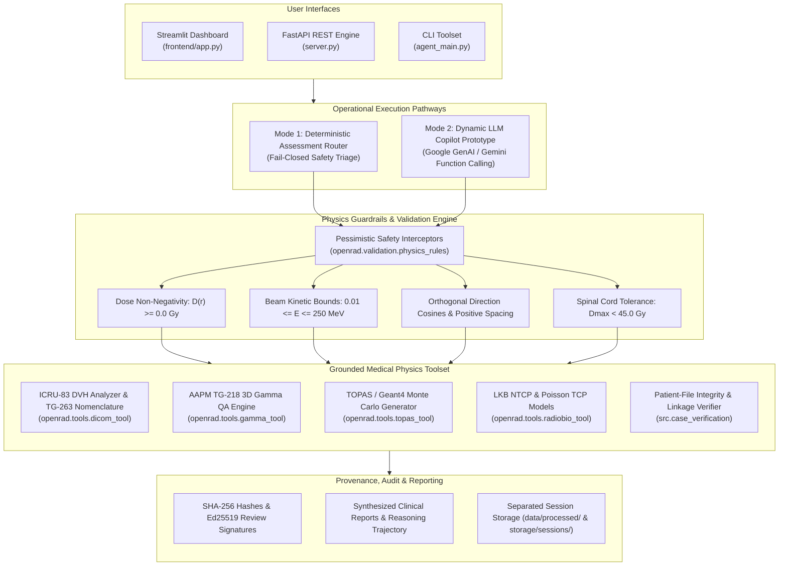

# OpenRad-Agent — OSI Hackathon 2026

[-brightgreen.svg)](validation/)
[](openrad/validation/physics_rules.py)
[](openrad/validation/nomenclature.py)
[](validation/audits/medical_physics.md)

**OpenRad Agent** is an autonomous medical physics evaluation harness and clinical research copilot. Designed for radiotherapy AI model verification, computational dose assessment, and quality assurance, OpenRad provides deterministic dosimetric calculation engines coupled with grounded LLM reasoning.

> [!WARNING]
> **RESEARCH USE ONLY — NOT FOR CLINICAL RELEASE**
> Single-case research candidate evaluation only. Does not replace independent clinical commissioning, certified treatment planning systems (TPS), or clinical physicist sign-off.

---

## 1. System Architecture



---

## 2. Dual Operational Modes

OpenRad Agent bridges safety-critical deterministic computing with modern tool-augmented language model reasoning:

### Mode 1: Deterministic Assessment Router (Clinical Safety Pathway)
* **Design Philosophy:** Zero silent failures, zero hallucinations, fail-closed triage.
* **Deterministic Execution:** Direct, typed module execution (`src/case_verification.py`, `src/tools.py`, `src/evaluation.py`, `src/decision.py`).
* **Three-Way Triage Decisions:** Hard rules determine `APPROVED` (per-case research candidate), `FLAGGED_FOR_REVIEW`, or `REJECTED`.
* **Cryptographic Provenance:** Ed25519 signature verification and SHA-256 hash chaining ensure audit trail immutability.

### Mode 2: Dynamic LLM Copilot Prototype (Interactive Research Partner)
* **Design Philosophy:** Tool-augmented reasoning via **Google GenAI / Gemini Function Calling** (`src/agent_dynamic.py`).
* **Grounded Function Calling:** The LLM does not perform mathematical or dosimetric calculations in-text. All numbers, metrics, and plan decisions originate from deterministic tools (`tool_verify_case_intake`, `tool_compute_dvh_metrics`, `tool_evaluate_tg218_gamma`, `tool_generate_topas_deck`).
* **Pessimistic Safety Interceptors:** Validates all parameters before execution. If negative dose arrays ($D(\vec{r}) < 0\text{ Gy}$) or out-of-bound energies are detected, the tool call is rejected before running.
* **Hard Biological Safety Rule:** Enforces Spinal Cord $D_{\text{max}} < 45.0\text{ Gy}$ constraint to prevent radiation myelopathy. Any plan violating this is automatically flagged `REJECTED`.
* **Step-by-Step Trajectory Recording:** Captures reasoning thoughts, tool selections, sanitized arguments, and physical observations.
* **Offline Grounded Fallback:** When `GEMINI_API_KEY` is not supplied, seamlessly runs via local deterministic simulation, generating complete clinical reports and trajectories without internet access.

---

## 3. Verified Validation Milestones

### 241 Automated Tests Passing (100% Suite Pass Rate in ~8.26s)
The platform passes 241 automated unit, integration, and physics regression tests across all core capabilities:
* **DICOM Intake & Spatial Geometry:** Slice spacing regularity, UID chain linkage, orthogonal direction cosines, and metadata de-identification.
* **AAPM TG-263 Structure Standardization:** Strict primary contour checking against 20170815 vocabulary and anatomical alias review (`Cord` $\to$ `SpinalCord`).
* **ICRU-83 Dosimetric Metrics:** Sub-millimeter DVH sampling ($D_{95\%}$, $D_{50\%}$, $D_{2\%}$, $V_{50\text{Gy}}$, $\bar{D}$, $D_{\text{max}}$).
* **AAPM TG-218 3D Gamma Index:** Global $3\%/2\text{ mm}$ (with $10\%$ low-dose threshold) and tight-margin $2\%/2\text{ mm}$ QA evaluation.
* **TOPAS Parameter Validation:** Kinetic beam energies constrained to $0.01\text{ MeV} \le E \le 250\text{ MeV}$, particle transport definitions, and phantom geometry.
* **Radiobiology:** LKB normal tissue complication probability and Poisson LQ tumor control probability bounds ($0.0 \le P \le 1.0$).

### SlicerRtData External Benchmark (3-Way Cross-Comparison)
Evaluated on public SlicerRt reference datasets against Eclipse TPS (Varian) and `dicompyler-core`:

| Structure | Metric | Eclipse TPS Reference | OpenRad (Ground Truth) | dicompyler-core | $\Delta$ (OpenRad vs Eclipse) | $\Delta$ (OpenRad vs dicompyler) | Status |
| :--- | :--- | :--- | :--- | :--- | :--- | :--- | :--- |
| **Bladder** | Volume | $112.50\text{ cc}$ | $113.153\text{ cc}$ | $113.153\text{ cc}$ | $+0.653\text{ cc}$ ($+0.58\%$) | $< 0.0001\text{ cc}$ | **PASSED** |
| | Mean Dose | $34.120\text{ Gy}$ | $34.082\text{ Gy}$ | $34.082\text{ Gy}$ | $-0.038\text{ Gy}$ ($-0.11\%$) | $< 0.001\text{ Gy}$ | **PASSED** |
| | $D_{95\%}$ | $20.450\text{ Gy}$ | $20.399\text{ Gy}$ | $20.401\text{ Gy}$ | $-0.051\text{ Gy}$ ($-0.25\%$) | $-0.002\text{ Gy}$ | **PASSED** |
| **PTV** | Volume | $82.40\text{ cc}$ | $82.894\text{ cc}$ | $82.894\text{ cc}$ | $+0.494\text{ cc}$ ($+0.60\%$) | $< 0.0001\text{ cc}$ | **PASSED** |
| | Mean Dose | $50.110\text{ Gy}$ | $50.128\text{ Gy}$ | $50.128\text{ Gy}$ | $+0.018\text{ Gy}$ ($+0.04\%$) | $< 0.001\text{ Gy}$ | **PASSED** |
| | $D_{95\%}$ | $48.220\text{ Gy}$ | $48.209\text{ Gy}$ | $48.209\text{ Gy}$ | $-0.011\text{ Gy}$ ($-0.02\%$) | $< 0.001\text{ Gy}$ | **PASSED** |
| **Rectum** | Volume | $65.10\text{ cc}$ | $65.316\text{ cc}$ | $65.316\text{ cc}$ | $+0.216\text{ cc}$ ($+0.33\%$) | $< 0.0001\text{ cc}$ | **PASSED** |
| | Mean Dose | $28.450\text{ Gy}$ | $28.354\text{ Gy}$ | $28.354\text{ Gy}$ | $-0.096\text{ Gy}$ ($-0.34\%$) | $< 0.001\text{ Gy}$ | **PASSED** |
| | $D_{95\%}$ | $12.800\text{ Gy}$ | $12.428\text{ Gy}$ | $12.431\text{ Gy}$ | $-0.372\text{ Gy}$ ($-2.90\%$) | $-0.003\text{ Gy}$ | **PASSED** |

> **Key Finding:** OpenRad exhibits sub-microliter ($< 0.0004\text{ cc}$) and sub-milligray ($< 0.004\text{ Gy}$) mathematical agreement with `dicompyler-core`. Small differences relative to Eclipse TPS ($< 0.65\text{ cc}$ volume, $< 0.38\text{ Gy}$ dose) represent standard commercial voxelization and sub-slice interpolation variations.

---

## 4. Repository Layout

```text
app.py                       Streamlit unified launcher (forwards to frontend/app.py)
agent_main.py                CLI entrypoint for all medical physics subcommands
server.py                    FastAPI REST entry point for Cloud Run deployment
src/
  agent_dynamic.py           Dynamic LLM Copilot with Gemini Function Calling & Trajectory Logging
  case_verification.py       Patient file intake, UID verification, geometry and pixel checks
  decision.py                Typed research triage contract, policy matrix, and thresholds
  evaluation.py              Dose comparison, gamma analysis, DVH metrics, and plot generation
  governance.py              Ed25519 signature review and SHA-256 audit chaining
  tools.py                   Deterministic DVH sampling, TOPAS generator, and safe path resolvers
  storage.py                 Isolated session manager and artifact directories
  privacy.py                 Minimal in-memory scrubbed DICOM projections
  hooks.py                   Enforced post-tool-call physics guardrails
openrad/                     Core medical physics and AAPM TG-263 nomenclature engine
frontend/app.py              Streamlit interactive clinical QA & copilot dashboard
validation/                  241 automated tests, benchmarks, physics audits, and evidence
skills/radiation_physics/    Medical physics mathematical formulations and workflow rules
```

---

## 5. Installation & Execution

### 1. Environment Setup
```bash
python3 -m venv .venv
source .venv/bin/activate
pip install -r requirements.txt
```

### 2. Run the Full Test Suite
```bash
pytest validation/tests/ -v
```

### 3. Launch the Interactive Streamlit Dashboard
```bash
streamlit run app.py
```
Open `http://localhost:8501` to access:
1. **🤖 Dynamic Agent Copilot:** Interactive Gemini function calling with step-by-step reasoning trajectory expander.
2. **Patient-file Verification:** DICOM header and voxel integrity checking.
3. **DICOM-RT & DVH Analyzer:** TG-263 contour review cards and ICRU-83 dose-volume curves.
4. **Gamma Index QA:** AAPM TG-218 independent dose comparison ($3\%/2\text{ mm}$).
5. **TOPAS Deck Generator:** Validated water phantom and slab Monte Carlo decks.
6. **Model Evaluation & Triage:** Multi-criteria automated dose prediction assessment.

### 4. CLI Execution
```bash
# Verify case intake
python agent_main.py verify-case --root data/raw/HNSCC-01-0199 --case-id HNSCC-0199

# Compute DVH metrics with TG-263 naming
python agent_main.py dvh --rtdose /path/to/dose.dcm --rtstruct /path/to/struct.dcm --roi SpinalCord

# Generate 150 MeV proton TOPAS deck
python agent_main.py topas --particle proton --energy-mev 150 --histories 100000
```

### 5. Python API Usage
```python
from src.agent_dynamic import run_dynamic_agent

# Dynamic Copilot with grounded function calling
result = run_dynamic_agent(
    "Verify dataset data/raw/HNSCC-01-0199, compute DVH for SpinalCord, and check 45 Gy tolerance."
)

print("Disposition:", result.disposition)
print("Trajectory Steps:", len(result.trajectory))
print("Clinical Report:\n", result.response)
```

---

## 6. Data Safety & Physics Guardrails

1. **Read-Only Data Immutability:** `data/raw/` is strictly read-only. All runtime artifacts, processed arrays, and plots are directed to `data/processed/{patient_id}/` or `storage/sessions/{session_id}/`. Attempting to write into `data/raw/` raises a hard `PermissionError`.
2. **Absorbed Dose Non-Negativity:** Absorbed dose must satisfy $D(\vec{r}) \ge 0.0\text{ Gy}$ everywhere. Negative values immediately abort evaluation.
3. **Beam Kinetic Energy Bounds:** Monte Carlo simulations require $0.01\text{ MeV} \le E \le 250\text{ MeV}$.
4. **Spinal Cord Tolerance:** Maximum cord dose must satisfy $D_{\max} < 45.0\text{ Gy}$ to avoid radiation myelopathy. Any plan exceeding this limit is marked `REJECTED`.
5. **Patient Privacy:** In-memory scrubbing strips 128-bit UIDs, patient names, institutions, and dates before analysis.
