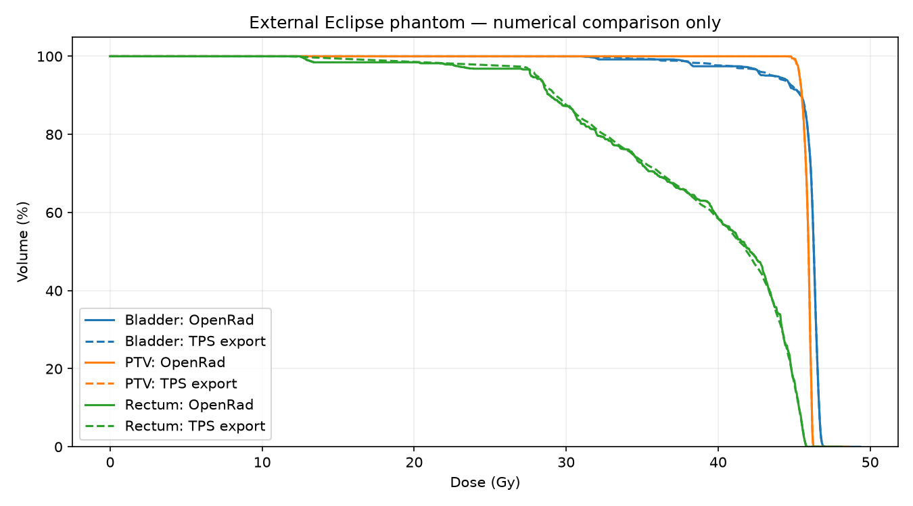

# Reviewed rectification evidence

The [22 October 2026 assessment](2026-10-22/assessment.json) binds the tested source tree by SHA-256. It records **341 passing regressions**, **28/28 strict menu scenarios**, **96 gamma oracle comparisons**, **21 triage controls**, **11 DICOM controls** and **1,450 seeded numerical checks**. Original raw sources remained unchanged. Source-only benchmarks can include explicitly labeled engineering controls; these are not extra independent patients or clinical model proof.

- [Finding dispositions and remaining release gates](2026-10-22/DISPOSITIONS.md)
- [Tested source-tree manifest](2026-10-22/tested-source-tree.json)
- [Expanded numerical gamma evidence](2026-10-22/gamma-oracles.json)
- [Triage engineering controls](2026-10-22/triage-controls.json)
- [Public phantom comparison](2026-10-22/public-phantom-comparison.json)
- [Resolved environment](2026-10-22/environment.json)
- [Dependency advisory/backport discrepancy](2026-10-22/dependency-advisory.json)
- [Operating instructions](../../../docs/HARDENING.md)

The suite first reproduced 26 failing boundary regressions before the fixes; all tested cases pass after rectification. A cold Python 3.13 frontend test initially hit its implicit 3 second budget; its explicit 15 second startup budget now matches the other UI tests while preserving assertions. Deprecation warnings remain recorded; passing tests are not a zero-defect, clinical-usability or standards-conformity certificate.

Only aggregate local-cohort counts and public phantom numerical outputs are published. Raw DICOM, private patient inventories, diagnostic paths/logs and credentials stay ignored/local. Full clinical qualification, shared authenticated durable deployment and current live Gemini/transport-runtime qualification remain unestablished. See the dispositions before relying on any result.
