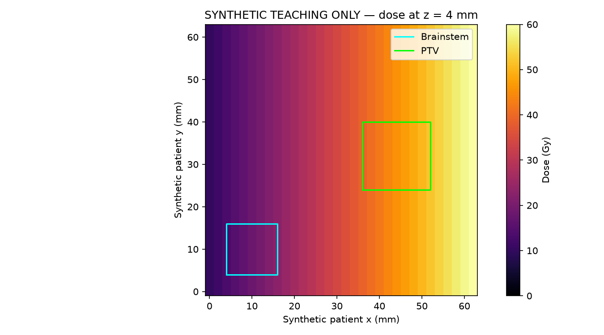
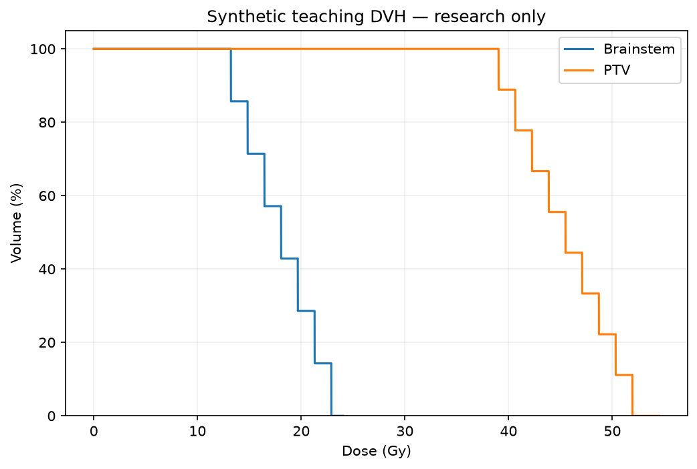

# Synthetic showcase evidence

The portable [DICOM teaching examples](../../../data/demo/README.md) contain no patient-derived data. The clean example passed pixel-enabled intake and both ROI calculations; missing-image, wrong-frame and negative-scaling examples were blocked. Controlled gamma comparisons returned 100% and 0% at 3%/2 mm, 10% cutoff. These are engineering demonstrations, not clinical qualification or independent model references.

Seven Streamlit AppTest steps passed: app load, prepared-case verification, DVH handoff, both curves, missing-image review, built-in generation and generated-case verification. See [UI evidence](2026-10-22/UI_VERIFICATION.json), [intake summary](2026-10-22/VERIFICATION_SUMMARY.json), [DVH measurements](2026-10-22/DVH_METRICS.json) and [gamma controls](2026-10-22/GAMMA_CONTROLS.json). Published reports omit runtime paths/session artifacts; source DICOM hashes live with the data.

