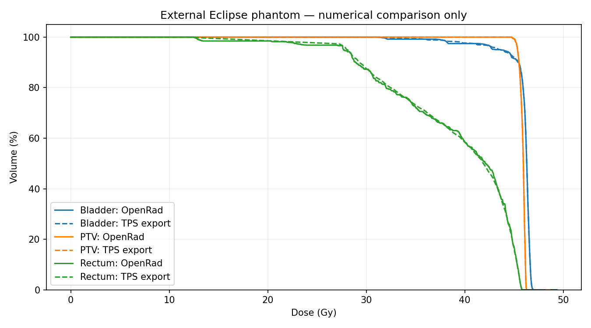

# SlicerRT external-data assessment

Source commit: 704936e8889c77174a0dd97cfb8703b47952e62c

Research compatibility evidence only; no model or clinical approval.

| Dataset | Intake state | Findings |
|---|---|---|
| plastimatch_tiny-rt-study | [BLOCKED](sessions/61b8f803-86dc-42b1-9cc1-5ab490afc503/artifacts/report_9de7348bf2774a5abaf5f934eb2e89a5.md) | BLOCK: course_linkage (1), REVIEW: burned_in_annotation (11), REVIEW: roi_name_review (2), INFO: completeness_scope (1) |
| oncentra-4.1.6-prostate-ct-tilted-plane | [FLAGGED_FOR_REVIEW](sessions/4c704dde-c2da-487e-aac8-48c7dbf5b407/artifacts/report_674d795d64cc4558b8a6b118d74e2688.md) | REVIEW: burned_in_annotation (12), REVIEW: roi_contours_absent (1), REVIEW: roi_name_review (2), REVIEW: contour_orientation_scope (8), REVIEW: missing_rt_course (1), REVIEW: uninspected_files (1), INFO: completeness_scope (1) |
| xio-4.60.00-phantom-irregular-spacing | [BLOCKED](sessions/7bf2cef0-f6cb-4240-844f-39fe62df2337/artifacts/report_65a797a65b4d4ac6a202bcc92aaaf901.md) | BLOCK: dicom_read (29), BLOCK: no_dicom (1), REVIEW: missing_ct (1), REVIEW: missing_rt_course (1), REVIEW: uninspected_files (1), INFO: completeness_scope (1) |
| aria-phantom-contours-keyhole | [FLAGGED_FOR_REVIEW](sessions/72bf1e00-86c2-4031-9cd6-3677b8d278be/artifacts/report_73814c431fd34035b9da311fe9ef5586.md) | REVIEW: burned_in_annotation (153), REVIEW: roi_contours_absent (1), REVIEW: roi_name_review (48), INFO: completeness_scope (1) |
| eclipse-8.1.20-phantom-prostate | [FLAGGED_FOR_REVIEW](sessions/d29b059d-1501-405b-9c66-1d79b2fd2483/artifacts/report_42efee36e0bc44dcb2a7afaa10306374.md) | REVIEW: burned_in_annotation (93), REVIEW: plan_frame_absent (1), REVIEW: unsupported_modality (4), REVIEW: roi_contours_absent (1), REVIEW: roi_name_review (11), INFO: completeness_scope (1) |

## Eclipse phantom comparison

Observed differences; no clinical acceptance tolerance established. TPS export and dicompyler-core are numerical comparators, not measured truth.

| Structure | OpenRad − TPS volume (cc) | Mean dose (Gy) | D95 (Gy) | D50 (Gy) | D2 (Gy) |
|---|---:|---:|---:|---:|---:|
| Bladder | +0.6530 | -0.0380 | -0.0514 | -0.0061 | -0.0014 |
| PTV | +0.4940 | +0.0180 | -0.0105 | +0.0028 | -0.0021 |
| Rectum | +0.2160 | -0.0960 | -0.3715 | +0.2142 | -0.0009 |

- TPS export is a numerical comparator, not independently measured dose truth.
- TPS summary means are rounded relative-dose values; inverse cumulative D metrics use linear interpolation.
- OpenRad uses axial voxel-center sampling, inferred uniform contour slabs and linear z-dose interpolation; curve threshold spacing is exported explicitly (normally 0.01 Gy).
- dicompyler-core uses its default rasterization and dose-bin settings. Differences are observations, not validated clinical error margins.
- No SlicerRT runtime execution or population-level model qualification was performed.

## Keyhole topology

Numeric topology probe only; no TG-263 alias or anatomical identity inferred. A keyhole encoding can be valid DICOM but outside this sampler.
Unsupported simple polygons detected: 0; selected probe rejected: False. Selected numeric contour probe was sampled; no anatomy or full topology correctness is established.
Dataset names do not establish topology or expected rejection. Full topology accuracy still needs independent reference masks/volumes.

## Follow-up actions

Inspect each generated case report. Resolve missing references, naming and unsupported geometry before calculating a DVH.
Compare supported DVHs with an independent implementation under recorded sampling settings. Do not treat source doses as measured truth.

All 314 pinned source files passed before/after content-hash checks.
