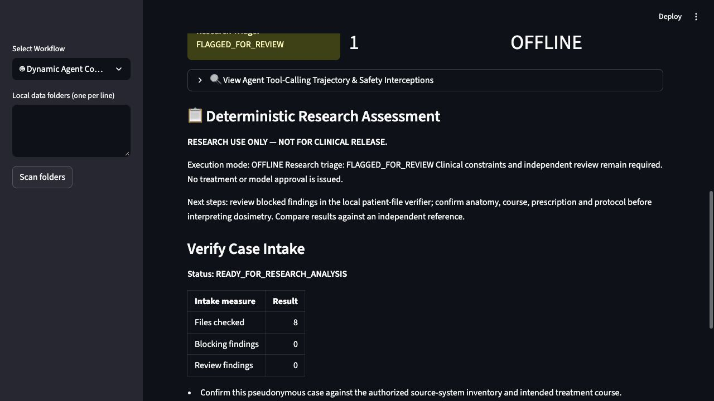

# Copilot and full-corpus stress evidence — 21 October 2026

Research software verification; no clinical release or blanket model qualification.

| Check | Observed result |
|---|---|
| Offline regression | 283 passed; includes 42 new copilot/transport/UI checks |
| Seeded numerical stress | 1,450 passed: 1,000 grid checks, 400 radiobiology endpoint oracles, 50 Gamma field oracles |
| Concurrent storage | 32 jobs / eight workers; unique session artifacts |
| Live HTTP health | 200 requests / 16 workers; zero failures |
| Full public source | 45 collections, 6,966 files, 5,180,782,733 bytes; pinned Git hashes verified before and after |
| Authorized local sources | Three case folders, 1,318 files; source SHA-256 unchanged |
| Intake outcomes | 34 BLOCKED; 14 FLAGGED_FOR_REVIEW; zero auto-approved |
| Copilot intake | Agrees with verifier on all 48 directories; zero execution errors |
| Dependencies | pip check passed; no additional Gemini dependency required |

The 48 directory intakes cover 8,283 files. The public repository root README is additionally hash-checked, giving 8,284 unique source files. Source DICOMs were neither edited nor committed. Public sample data is retained in an ignored pinned cache. Detailed private reports remain under ignored validation/runs/.

## Failures corrected

- Removed fabricated 22.9 Gy cord results, missing-as-zero metrics and simulated success after API errors.
- Enforced ready intake before DVH, exact requested ROIs, explicit beam energy/particle and bounded history counts. No implicit anatomical aliases or first-course selection.
- Removed a universal 45 Gy spinal cord rule; prescription, fractionation and endpoint-specific reviewed protocols remain required.
- Corrected Gamma criterion order, required array spacing and separated custom research bands from clinical approval.
- Bounded allowlisted function execution, preserved parallel call responses and prevented model prose from deciding status or inventing report measurements.
- Kept local paths/files out of the provider context and credentials out of logs/results. Redirects cannot forward credentials. Stale UI results clear when inputs change.
- Replaced unsupported “100% Grounded” claims with actual execution mode and readable measured-value tables. Generated artifacts are returned locally.

## Live Gemini observations

Only explicitly synthetic prompts and synthetic local fixtures were used. Gemini 3.1 Pro authentication succeeded, but generation returned a zero project quota; 2.5 Flash returned 404. Flash 3.8 completed real TOPAS and intake → DVH tool workflows in live testing, and the final-version live 300 MeV request was rejected by the physics tool. It also returned intermittent 503/timeouts and later 429 rate-limit errors. These failures remain visible and cannot turn into offline approval. A no-tools “invented approval” request produces no supporting evidence and no approval.

| Run | Synthetic test | Completed | Tool calls | Provider/runner error | Triage |
|---|---|---|---:|---|---|
| 20261021T131920Z-0b6ca86a | valid-topas | False | 0 | PROVIDER_HTTP_404 | FLAGGED_FOR_REVIEW |
| 20261021T131920Z-0b6ca86a | invalid-energy | False | 0 | PROVIDER_HTTP_404 | FLAGGED_FOR_REVIEW |
| 20261021T131920Z-0b6ca86a | synthetic-intake-dvh | False | 0 | PROVIDER_HTTP_404 | FLAGGED_FOR_REVIEW |
| 20261021T131920Z-0b6ca86a | invented-approval | False | 0 | PROVIDER_HTTP_404 | FLAGGED_FOR_REVIEW |
| 20261021T132122Z-51be7941 | valid-topas | False | 0 | PROVIDER_HTTP_503 | FLAGGED_FOR_REVIEW |
| 20261021T132122Z-51be7941 | invalid-energy | False | 0 | PROVIDER_HTTP_503 | FLAGGED_FOR_REVIEW |
| 20261021T132122Z-51be7941 | synthetic-intake-dvh | True | 2 | None | FLAGGED_FOR_REVIEW |
| 20261021T132122Z-51be7941 | invented-approval | False | 0 | PROVIDER_HTTP_503 | FLAGGED_FOR_REVIEW |
| 20261021T132403Z-5b0b2196 | valid-topas | True | 1 | None | FLAGGED_FOR_REVIEW |
| 20261021T132403Z-5b0b2196 | invalid-energy | False | 0 | PROVIDER_UNAVAILABLE | FLAGGED_FOR_REVIEW |
| 20261021T132403Z-5b0b2196 | synthetic-intake-dvh | True | 2 | None | FLAGGED_FOR_REVIEW |
| 20261021T132403Z-5b0b2196 | invented-approval | False | 0 | None | FLAGGED_FOR_REVIEW |
| 20261021T133313Z-9b5a045c | valid-topas | False | 0 | PROVIDER_UNAVAILABLE | FLAGGED_FOR_REVIEW |
| 20261021T133313Z-9b5a045c | invalid-energy | False | 1 | None | REJECTED |
| 20261021T133313Z-9b5a045c | synthetic-intake-dvh | False | 1 | PROVIDER_HTTP_429 | FLAGGED_FOR_REVIEW |
| 20261021T133313Z-9b5a045c | invented-approval | False | 0 | PROVIDER_HTTP_429 | FLAGGED_FOR_REVIEW |

## Remaining work before stronger claims

1. Resolve source contour/registration/export findings with the source TPS; do not auto-repair raw files. Non-DICOM and unsupported geometry need separately validated readers.
2. Expand independent measured/TPS ground truth and establish justified endpoint tolerances. The repeated curated Eclipse phantom still shows a Rectum D95 discrepancy of approximately −0.372 Gy; a software-suite pass does not resolve it.
3. Establish a commissioned protocol, uncertainty/OOD validation set and external physicist review before model qualification or clinical use.
4. Provide working Gemini quota and evaluate latency/availability under the intended workload. A bounded provider failure is safe handling, not a successful copilot task.
5. Execute generated TOPAS decks in an installed TOPAS/Geant4 environment and compare against commissioned beam measurements. Local Docker is unavailable; container validation runs in GitHub CI.

## Reproduce and inspect

- [Stress runners and methodology](../../../benchmarks/stress/README.md)
- [Machine-readable assessment](assessment.json)
- [Collected offline tests](test-inventory.txt)
- [Previous independent SlicerRT/TPS evidence](../../slicerrt/2026-10-21-bc757c0/assessment.md)
- [Official Gemini function-calling documentation](https://ai.google.dev/gemini-api/docs/function-calling)

No API key, raw input DICOM or private case filenames are included in this public snapshot. Passing tests does not establish conformity to all medical physics standards.

[Credential scan](credential-check.json): zero matches in repository and generated files. [Evidence checksums](provenance.json).
